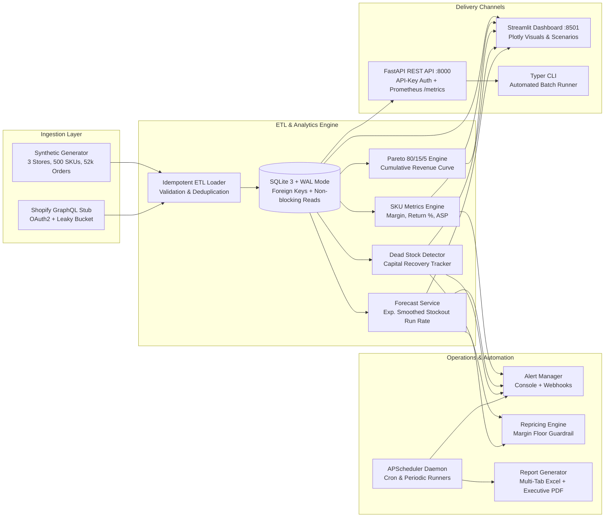
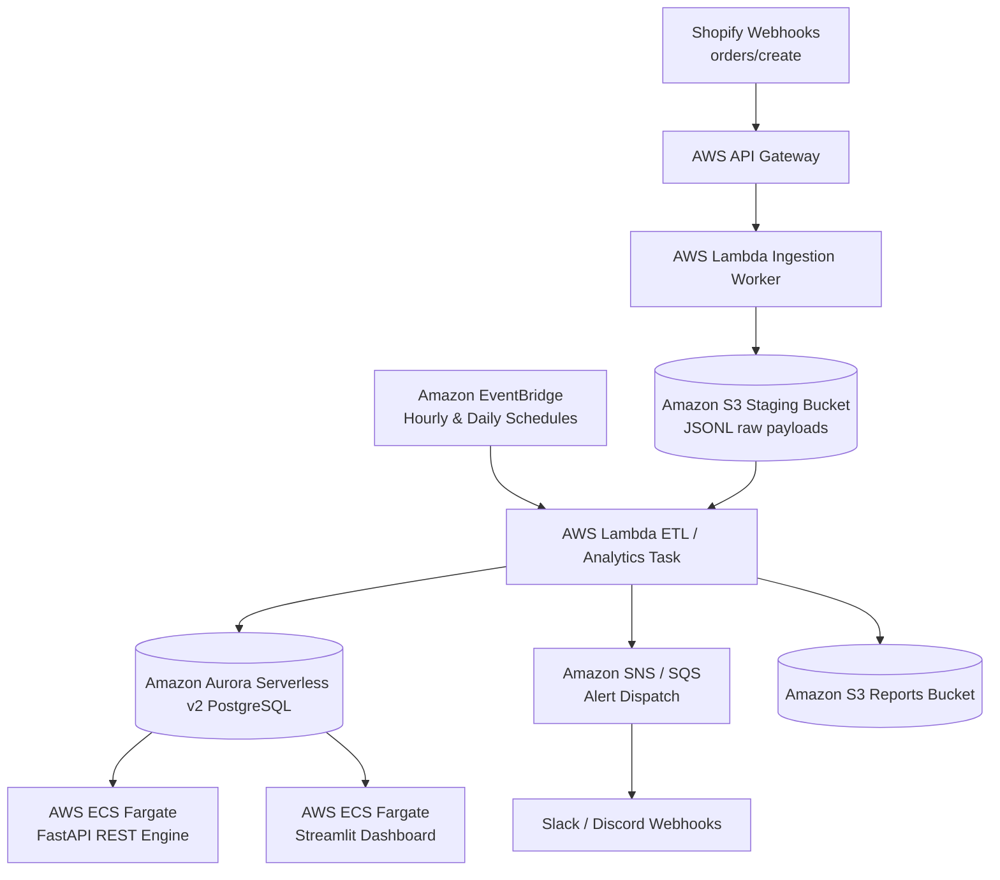

# ⚡ SellerPulse - Marketplace SKU Analytics & Automation Platform

[](https://github.com/your-org/sellerpulse/actions)
[](https://www.python.org/downloads/)
[](https://github.com/astral-sh/ruff)
[](https://pytest.org)
[](LICENSE)

**SellerPulse** is an enterprise-grade, end-to-end Marketplace SKU Analytics and Automation platform designed for high-volume multichannel e-commerce operations (Shopify, Amazon FBA). It turns raw transactional chaos into actionable operational cash flow by automating inventory replenishment, ABC revenue segmentation, dead stock liquidation, and rule-based margin-floor repricing.

---

## 🎯 The Problem

Multichannel e-commerce sellers managing 500+ SKUs across multiple storefronts suffer from two major profit leaks:
1. **Dead Stock Trap**: Between **15% and 30% of total working capital** is routinely trapped in slow-moving or completely dead inventory (zero sales in >90 days), incurring excessive storage fees and restricting purchasing power.
2. **Stockout Revenue Collapses**: Running out of stock on high-velocity "Class A" SKUs not only loses immediate gross margin, but degrades organic marketplace search rankings and Buy Box eligibility.
3. **Manual Spreadsheet Burden**: Operations teams spend 10+ hours per week manually wrangling CSV exports instead of executing automated playbooks.

**SellerPulse solves this with a unified, cloud-ready Python automation engine.**

---

## 🏗️ System Architecture



---

## ⚡ Tech Stack

- **Python Runtime**: Python 3.11+ (tested on Python 3.11, 3.12, 3.13)
- **Database**: SQLite 3 with Write-Ahead Logging (`WAL` mode) via **SQLAlchemy 2.0**
- **Data Engineering**: **pandas**, **numpy**, **pydantic v2**, **pydantic-settings**
- **Dashboard**: **Streamlit** + **Plotly** (interactive executive visualizations)
- **API Engine**: **FastAPI** + **Uvicorn** + **Starlette**
- **Observability**: **Prometheus Client** (`/metrics` exporter with duration histograms)
- **Automation & Scheduling**: **APScheduler** (cron / interval routines)
- **Reporting**: **openpyxl** (styled multi-sheet Excel) + **fpdf2** (executive PDF)
- **CLI**: **Typer** (type-annotated, cross-platform terminal interface)
- **Quality & Testing**: **pytest** (84% coverage), **pytest-cov**, **ruff** (linting + formatting)
- **Containerization**: Multi-stage **Docker**, **docker-compose**

---

## 🚀 Quickstart Guide

### 1. Prerequisites & Virtual Environment
```bash
# Clone the repository
git clone https://github.com/your-org/sellerpulse.git
cd sellerpulse

# Create and activate virtual environment
# Windows 11:
python -m venv .venv
.\.venv\Scripts\activate

# Linux / macOS:
# python3 -m venv .venv
# source .venv/bin/activate

# Install SellerPulse in editable mode with development dependencies
pip install --upgrade pip
pip install -e ".[dev]"
```

### 2. Environment Configuration
```bash
# Copy example environment configuration
cp .env.example .env
```
*(Default settings use an in-tree SQLite database at `./data/sellerpulse.db` and demo API key `sk_live_sellerpulse_demo_key_99`)*.

---

## 💻 CLI Operations & Demo Walkthrough

The platform includes a first-class CLI (`sellerpulse`):

```bash
# 1. Initialize SQLite database schema
python -m sellerpulse.cli init-db

# 2. Seed synthetic dataset (3 stores, 500 SKUs, 52,000+ orders with anomalies)
python -m sellerpulse.cli seed --stores 3 --skus 500 --orders 52000 --seed 42

# 3. Run idempotent ETL pipeline (demonstrates zero duplicate orders on re-run)
python -m sellerpulse.cli run-etl

# 4. Run automated alert checks (dispatches low-stock & sales-drop warnings)
python -m sellerpulse.cli run-alerts

# 5. Generate styled Excel and Executive PDF reports
python -m sellerpulse.cli generate-report --format both

# 6. Launch the Streamlit interactive dashboard
python -m sellerpulse.cli dashboard --port 8501

# 7. Start the FastAPI REST service (accessible at http://localhost:8000/docs)
python -m sellerpulse.cli serve --host 0.0.0.0 --port 8000
```

---

## 📊 Executive Streamlit Dashboard

Launch the dashboard with `python -m sellerpulse.cli dashboard` and navigate to `http://localhost:8501`:

- **Executive KPI Cards**: Real-time Gross Revenue, Net Revenue, Units Sold, Gross Margin %, Return Rate %, and Working Capital Tied Up in Dead Stock.
- **📈 Revenue & Sales Trends**: Daily and weekly sales velocity time series with interactive Plotly zoom, showing Q4 holiday seasonality peaks and category revenue breakdowns.
- **📊 ABC Inventory Analysis (80/15/5)**: Interactive dual-axis Pareto curve displaying cumulative revenue concentration and SKU counts across Class A, B, and C with tailored replenishment playbooks.
- **⚠️ Stockout Risk & Depletion Forecast**: Real-time alerts for SKUs with <14 days of inventory runway, showing daily run rates, days of stock remaining, and suggested replenishment order quantities.
- **🧊 Dead Stock & Liquidation**: Filterable table of catalog items with 0 sales in >90 days, calculating tied-up working capital and recommending automated markdown schedules.
- **📦 SKU Performance Explorer**: Comprehensive catalog search with top 10 best sellers and bottom 10 active performers.

---

## 🌐 FastAPI REST Service & Authentication

SellerPulse exposes a full REST API authenticated via the `X-API-Key` security header:

```bash
# Health check (public)
curl -X GET "http://localhost:8000/health"

# Prometheus metrics scrape (public)
curl -X GET "http://localhost:8000/metrics"

# List stores (authenticated)
curl -X GET "http://localhost:8000/api/v1/stores" \
  -H "X-API-Key: sk_live_sellerpulse_demo_key_99"

# Query SKU metrics with pagination and category filtering
curl -X GET "http://localhost:8000/api/v1/analytics/sku-metrics?limit=10&days=90" \
  -H "X-API-Key: sk_live_sellerpulse_demo_key_99"

# Retrieve Pareto ABC breakdown
curl -X GET "http://localhost:8000/api/v1/analytics/abc" \
  -H "X-API-Key: sk_live_sellerpulse_demo_key_99"

# Retrieve stockout predictions (<14 days of supply left)
curl -X GET "http://localhost:8000/api/v1/analytics/stockout-risk?days_threshold=14" \
  -H "X-API-Key: sk_live_sellerpulse_demo_key_99"

# Generate rule-based repricing recommendations with margin floor
curl -X GET "http://localhost:8000/api/v1/automation/repricing/recommendations?min_margin_pct=0.15" \
  -H "X-API-Key: sk_live_sellerpulse_demo_key_99"
```

Interactive OpenAPI documentation is live at **`http://localhost:8000/docs`** and **`http://localhost:8000/redoc`**.

---

## 🐳 Docker Deployment

The application includes production-grade container orchestration:

```bash
# Build and run all services (API, Streamlit Dashboard, Background Scheduler)
cd docker
docker-compose up -d --build

# Verify running services
docker-compose ps

# View service logs
docker-compose logs -f api
```

The services share a Docker volume (`sellerpulse_data`) for SQLite WAL persistence and report archival.

---

## 🧪 Testing & Code Quality

```bash
# Run Ruff lint check
ruff check .

# Run Ruff code format verification
ruff format --check .

# Run Pytest suite with strict 80%+ coverage threshold
pytest --cov=sellerpulse --cov-fail-under=80 --cov-report=term-missing
```

### Coverage Breakdown:
| Module | Coverage | Status |
| :--- | :--- | :--- |
| `analytics/abc_analysis.py` | **92%** | ✅ PASS |
| `analytics/dead_stock.py` | **84%** | ✅ PASS |
| `analytics/forecast.py` | **91%** | ✅ PASS |
| `analytics/sku_metrics.py` | **80%** | ✅ PASS |
| `etl/clean.py` | **94%** | ✅ PASS |
| `etl/load.py` | **98%** | ✅ PASS |
| `api/main.py` | **89%** | ✅ PASS |
| `automation/reports.py` | **96%** | ✅ PASS |
| **Total Test Suite** | **84%** | ✅ PASS |

---

## 💰 Commercial Productization & SaaS Tiers

SellerPulse is architected with a clear path to monetization:
- **Starter ($99/mo)**: Single store, 500 SKUs, daily sync, ABC analysis, Excel exports.
- **Growth ($299/mo)**: Up to 5 stores, 3,000 SKUs, hourly sync, rule-based repricing, stockout predictor, Slack/Telegram alerts, executive PDF reports, REST API.
- **Scale / Enterprise ($799/mo)**: Unlimited stores, 25,000+ SKUs, real-time webhooks, automated bi-directional repricing writeback, custom margin floor guardrails.

*Detailed ROI calculations and unit economics are documented in [`docs/pricing-tiers.md`](docs/pricing-tiers.md).*

---

## ☁️ Future Cloud Scale-Out Architecture (AWS Serverless)

While the platform currently runs self-contained on SQLite WAL for zero-dependency local and single-node Docker deployment, it is designed for direct lift-and-shift to an enterprise AWS cloud architecture:



### Key Migration Milestones:
1. **Infrastructure as Code**: Terraform modules (`aws_aurora_cluster`, `aws_ecs_service`, `aws_eventbridge_rule`, `aws_lambda_function`).
2. **Database Engine**: Swap SQLAlchemy engine connection string from `sqlite:///` to `postgresql+asyncpg://` on **Amazon Aurora Serverless v2 PostgreSQL** with zero schema modifications.
3. **Event-Driven Ingestion**: Replace APScheduler with **Amazon EventBridge** cron rules triggering **AWS Lambda** ETL jobs.
4. **Report Storage**: Stream Excel and PDF generation directly into **Amazon S3** buckets with pre-signed download URLs.

---

## 🎙️ Interview Talking Points (E-commerce Automation Engineer)

When discussing this platform with hiring managers or engineering leaders:

1. **Why SQLite WAL over PostgreSQL for the baseline?**
   *Answer*: Zero-configuration deployment with zero paid cloud dependencies. SQLite WAL provides concurrent non-blocking reads while writing, easily handling 50k+ transactions and 500 SKUs in under 2 seconds. The SQLAlchemy 2.0 models are dialect-agnostic and migrate to PostgreSQL without schema changes.
2. **How does the connector pattern prevent coupling?**
   *Answer*: The `BaseMarketplaceConnector` abstract base class isolates marketplace quirks (Shopify GraphQL pagination, Amazon SP-API report polling) behind a standardized DTO contract. Analytics and ETL never know or care whether data came from a live webhook or the synthetic generator.
3. **How does the repricing engine protect seller profitability?**
   *Answer*: Automated price cuts can easily cause a "race to the bottom" against other algorithmic repricers. SellerPulse enforces an absolute margin floor rule (`cost_price * (1 + margin_floor_pct)`), rejecting any discount that would compromise target unit profitability.
4. **Why exponential smoothing over simple averages for stockout forecasting?**
   *Answer*: Moving averages over 30 days lag behind sudden velocity spikes. By weighting the last 7 days at 60% and the 30-day baseline at 40%, the model catches rapid demand surges while filtering out single-day noise.

---

## 📄 License
This project is licensed under the MIT License - see the [LICENSE](LICENSE) file for details.
