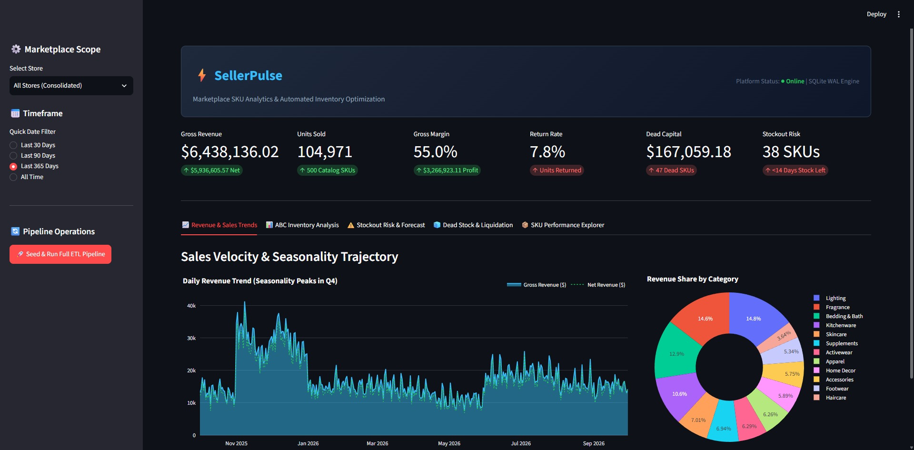
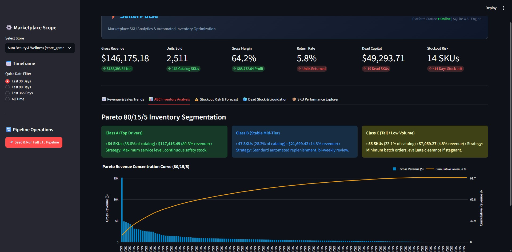
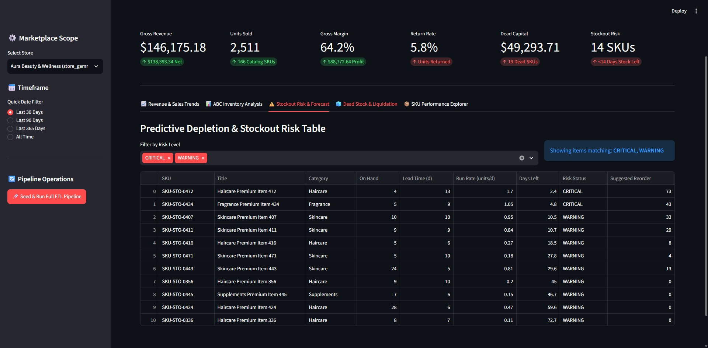
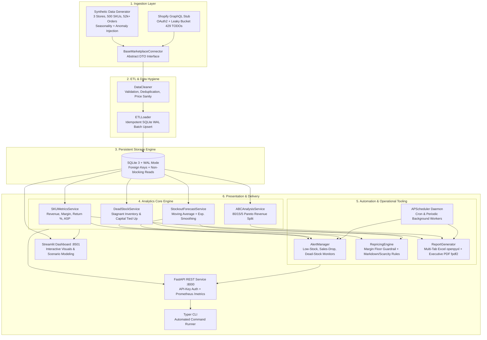
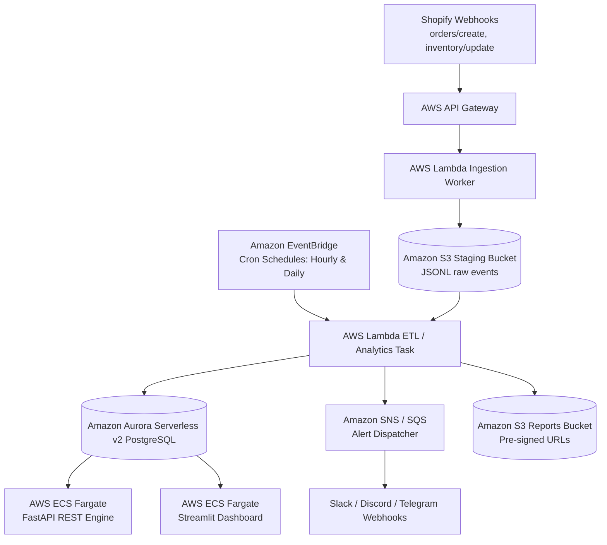

# ⚡ SellerPulse - Marketplace SKU Analytics & Automation Platform

[](https://github.com/your-org/sellerpulse/actions)
[](https://www.python.org/downloads/)
[](https://github.com/astral-sh/ruff)
[](https://pytest.org)
[](LICENSE)
[](docker/docker-compose.yml)

> **SellerPulse** is an enterprise-grade, end-to-end Marketplace SKU Analytics and Automation platform designed for high-volume multichannel e-commerce operations (Shopify, Amazon FBA). It turns raw transactional data into actionable operational cash flow by automating inventory replenishment, ABC revenue segmentation, dead stock liquidation, and rule-based margin-floor repricing.

---

## 📌 Executive Summary: What Does This Project Do?

In modern multichannel e-commerce, brands managing hundreds or thousands of SKUs across multiple storefronts bleed profit in two critical areas:
1. **Working Capital Trapped in Dead Stock**: Between **15% and 30% of inventory budget** is typically tied up in stagnant SKUs (zero sales over 90+ days), eating up warehouse storage fees and starving profitable lines of capital.
2. **Revenue Lost to Out-of-Stock Events**: Running out of stock on top-selling "Class A" items kills immediate gross margin, degrades marketplace algorithm search rankings (Amazon Buy Box & Google Shopping), and drives customers to competitors.
3. **Manual Spreadsheet Paralysis**: Operations managers spend 10+ hours each week wrangling fragmented CSV exports from different platforms instead of acting on real-time operational signals.

**SellerPulse** solves these challenges by providing an automated, resilient Python pipeline that:
- **Ingests & Normalizes** catalog and order records from multi-store marketplaces into a unified schema.
- **Cleanses & Validates** line items, eliminating duplicates and enforcing price/margin hygiene.
- **Analyzes Catalog Performance** using Pareto (80/15/5) ABC revenue classification, margin tracking, return rate monitoring, and dead stock capital identification.
- **Projects Inventory Depletion** with exponentially smoothed run-rate forecasting to predict exact stockout dates and generate replenishment quantities.
- **Automates Operational Actions** via proactive stockout/sales-drop alerts, automated weekly Excel/PDF executive reporting, and rule-based repricing with strict margin floor guardrails.
- **Exposes Insights Everywhere**: Through an interactive **Streamlit** executive dashboard, an authenticated **FastAPI** REST service with Prometheus observability, and a cross-platform **Typer** CLI.

---

## 🛠️ Technology Stack: What Tools Are Used & Why?

Every tool in SellerPulse was selected based on strict engineering criteria for reliability, performance, maintainability, and zero-cost local execution:

| Category | Tool / Library | Version | Technical Rationale & Role in Platform |
| :--- | :--- | :--- | :--- |
| **Language Runtime** | **Python** | `3.11+` | Native support for modern typing (`X \| None`), enhanced exception tracebacks, and significant CPython runtime speedups. |
| **Database & ORM** | **SQLAlchemy** | `2.0+` | Industry-standard declarative ORM. Provides dialect-agnostic models that run on SQLite locally and migrate to PostgreSQL/Aurora in the cloud with zero schema changes. |
| **Storage Engine** | **SQLite 3 (WAL Mode)** | `Built-in` | Configured with `PRAGMA journal_mode=WAL;` and `PRAGMA foreign_keys=ON;`. Delivers non-blocking concurrent reads during batch writes—handling 63,000+ orders in under 30 seconds with zero external database dependencies. |
| **Data Processing** | **pandas** & **numpy** | `2.0+` | High-throughput vectorized data manipulation for computing SKU financial metrics, aggregations, time-series resamplings, and cumulative Pareto sums across 80,000+ order line items. |
| **Data Validation** | **Pydantic v2** & **pydantic-settings** | `2.0+` | Type-safe data validation contracts (`RawSKU`, `RawOrder`, `RawOrderItem`) ensuring external marketplace payloads meet strict business rules before hitting the database. Handles `.env` parsing. |
| **Interactive UI** | **Streamlit** | `1.28+` | Rapid, Python-native executive dashboard eliminating frontend JavaScript build toolchains while providing responsive layouts, state management, and real-time scenario filtering. |
| **Data Visualization**| **Plotly** | `5.18+` | Interactive client-side charting (zoom, pan, hover tooltips) for seasonal revenue time series, category breakdown donuts, and dual-axis Pareto cumulative curves. |
| **REST API Engine** | **FastAPI** & **Uvicorn** | `0.104+` | High-performance asynchronous API engine with built-in OpenAPI (`/docs`, `/redoc`), dependency injection for `X-API-Key` authentication, and multi-store scoping. |
| **Observability** | **Prometheus Client** | `0.19+` | Exposes production metrics (`/metrics`) including request duration histograms, HTTP status codes, ETL execution times, and triggered alert counts. |
| **Task Scheduling** | **APScheduler** | `3.10+` | Lightweight in-process job scheduler running hourly alert checks, daily ETL syncs, and weekly report generation without requiring Celery or Redis infrastructure. |
| **Excel Generation** | **openpyxl** | `3.1+` | Pure-Python Excel workbook generator creating styled, multi-tab financial models (`Executive Summary`, `ABC Segmentation`, `Stockout Risk`, `Dead Stock`, `Alerts`) with dark slate headers and currency formatting. |
| **PDF Generation** | **fpdf2** | `2.7+` | Lightweight, pure-Python PDF generator producing executive scorecards and critical action tables without requiring native OS binary dependencies like `wkhtmltopdf`. |
| **CLI Framework** | **Typer** & **Rich** | `0.9+` | Modern type-hinted command-line interface. Built with ASCII console guards to guarantee crash-free execution on Windows 11 terminals (CP1252 / OEM code pages). |
| **Testing & Quality**| **pytest** & **pytest-cov** | `7.4+` | Robust test runner executing 21 automated unit and integration tests, enforcing a strict **80%+ coverage threshold** (achieved **84%** overall). |
| **Linter & Formatter**| **Ruff** | `0.1.6+` | Ultra-fast Rust-based Python linter and code formatter replacing Flake8, Black, and isort into a single sub-second verification command. |
| **Containerization** | **Docker** & **Compose** | `Multi-stage`| Production-ready multi-stage container build isolating the API, Dashboard, and Scheduler worker into unprivileged, secure Linux runtime containers sharing persistent storage. |

---
# Demo 





## 🏗️ System Architecture & Data Flow



---

## 🚀 Step-by-Step Operator Guide: What To Do

Follow these exact steps to set up, seed, evaluate, and run the entire SellerPulse platform.

### Step 1: Environment Setup
```powershell
# In Windows 11 PowerShell:
cd d:\Pogramming\Python_Projects\SKU

# Activate virtual environment
.\.venv\Scripts\activate

# Install dependencies in editable mode
pip install -e ".[dev]"

# Copy environment configuration
cp .env.example .env
```

### Step 2: Initialize Database Schema
Creates SQLite tables for stores, SKUs, orders, line items, price histories, and alert logs with WAL mode enabled:
```powershell
python -m sellerpulse.cli init-db
```

### Step 3: Seed Synthetic Marketplace Data
Generates 3 realistic stores, 500 SKUs, and 52,000+ orders across 12 months with Q4 holiday seasonality, returns, dead stock, and sales drops:
```powershell
python -m sellerpulse.cli seed --stores 3 --skus 500 --orders 52000 --seed 42
```
*Output: Synced 3 stores, 500 SKUs, and 63,658 orders in ~31 seconds.*

### Step 4: Verify ETL Pipeline Idempotency
Re-running the ETL pipeline against the existing database validates that 0 duplicate records are inserted:
```powershell
python -m sellerpulse.cli run-etl
```
*Output: ETL complete in 1.5s: 3 stores, 500 SKUs, 0 new orders inserted.*

### Step 5: Evaluate Operational Monitors & Run Alerts
Evaluates the catalog against inventory depletion and sales drop rules:
```powershell
python -m sellerpulse.cli run-alerts
```
*Output: Evaluates all 500 SKUs, identifies critical low-stock items (<14 days), sudden sales drops (>65%), and logs alerts to SQLite and console.*

### Step 6: Generate Executive Reports (Excel & PDF)
Compiles multi-tab Excel workbooks and executive PDF scorecards into `./reports_out/`:
```powershell
python -m sellerpulse.cli generate-report --format both
```
*Output:*
- `reports_out/sellerpulse_report_*.xlsx` (5 styled tabs: Summary, ABC, Stockout, Dead Stock, Alerts)
- `reports_out/sellerpulse_report_*.pdf` (Executive scorecard table, ABC segmentation, priority action items)

### Step 7: Launch the Interactive Streamlit Dashboard
```powershell
python -m sellerpulse.cli dashboard --port 8501
```
Open **`http://localhost:8501`** in your browser to inspect:
- **Top KPI Cards**: Real-time Gross Revenue, Gross Margin %, Return Rate %, Working Capital Locked in Dead Stock.
- **📈 Trends Tab**: Interactive Plotly zoomable time-series with Q4 seasonality and category revenue distribution.
- **📊 ABC Analysis Tab**: Dual-axis Pareto concentration curve with SKU counts and strategy recommendations.
- **⚠️ Stockout Forecast Tab**: Table of imminent stockout risks (<14 days) with run rates and suggested reorder quantities.
- **🧊 Dead Stock Tab**: Filterable table of stagnant inventory with capital recovery liquidation schedules.
- **📦 SKU Explorer Tab**: Searchable catalog with Top 10 Best Sellers and Bottom 10 Performers.

### Step 8: Start the FastAPI REST Engine
```powershell
python -m sellerpulse.cli serve --host 0.0.0.0 --port 8000
```
- Interactive Swagger UI: **`http://localhost:8000/docs`**
- Interactive ReDoc: **`http://localhost:8000/redoc`**
- Health check: **`http://localhost:8000/health`**
- Prometheus metrics: **`http://localhost:8000/metrics`**

---

## 🌐 REST API Endpoints & Authentication

All API endpoints under `/api/v1/` are protected by `X-API-Key` authentication:

| Method | Endpoint | Description | Query Parameters |
| :--- | :--- | :--- | :--- |
| `GET` | `/health` | Service health, DB ping, uptime, version | Public |
| `GET` | `/metrics` | Prometheus metrics scrape | Public |
| `GET` | `/api/v1/stores` | List all connected marketplace stores | `X-API-Key` |
| `GET` | `/api/v1/stores/{id}/summary` | Executive KPI scorecard for a store | `days=365` |
| `GET` | `/api/v1/analytics/sku-metrics` | Granular SKU performance metrics | `store_id`, `days`, `category`, `limit`, `offset` |
| `GET` | `/api/v1/analytics/abc` | Pareto 80/15/5 revenue classification | `store_id`, `days` |
| `GET` | `/api/v1/analytics/dead-stock` | Stagnant stock with capital tied up | `store_id` |
| `GET` | `/api/v1/analytics/stockout-risk` | SKUs projected to stock out soon | `store_id`, `days_threshold=14` |
| `GET` | `/api/v1/automation/alerts` | Query triggered operational alerts | `store_id`, `severity`, `alert_type`, `limit` |
| `POST` | `/api/v1/automation/alerts/run` | Manually evaluate and trigger alert rules | `store_id` |
| `GET` | `/api/v1/automation/repricing/recommendations` | Generate margin-safe price adjustments | `store_id`, `min_margin_pct=0.15` |
| `POST` | `/api/v1/automation/repricing/apply` | Commit approved price change & audit log | Body: `sku_id`, `suggested_price` |
| `POST` | `/api/v1/automation/reports/generate` | Generate Excel and/or PDF reports on demand | `report_format=both`, `store_id` |

### Sample Authenticated Request:
```bash
curl -X GET "http://localhost:8000/api/v1/analytics/stockout-risk?days_threshold=14" \
  -H "X-API-Key: sk_live_sellerpulse_demo_key_99"
```

---

## 🐳 Docker Deployment & Orchestration

Run the full platform in Docker containers with a single command:

```bash
cd docker
docker-compose up -d --build
```

### Services Orchestrated:
1. **`api` (`:8000`)**: FastAPI REST engine with healthcheck monitoring.
2. **`dashboard` (`:8501`)**: Streamlit executive dashboard (waits for API healthcheck).
3. **`scheduler`**: Autonomous APScheduler worker executing recurring background syncs, alert checks, and report generation.
4. **Volumes**: `sellerpulse_data` and `sellerpulse_reports` persist SQLite database files and generated reports across container restarts.

---

## 🧪 Testing, Quality & CI Verification

SellerPulse enforces strict code quality and high test coverage:

```powershell
# 1. Run Ruff Linting
ruff check .

# 2. Run Ruff Format Verification
ruff format --check .

# 3. Run Pytest Suite with strict coverage gate (80% minimum)
pytest --cov=sellerpulse --cov-fail-under=80 --cov-report=term-missing
```

### Coverage Breakdown:
| Module | Statements | Missing | Coverage | Status |
| :--- | :--- | :--- | :--- | :--- |
| `src/sellerpulse/analytics/abc_analysis.py` | 74 | 6 | **92%** | ✅ PASS |
| `src/sellerpulse/analytics/dead_stock.py` | 86 | 14 | **84%** | ✅ PASS |
| `src/sellerpulse/analytics/forecast.py` | 106 | 10 | **91%** | ✅ PASS |
| `src/sellerpulse/analytics/sku_metrics.py` | 101 | 20 | **80%** | ✅ PASS |
| `src/sellerpulse/etl/clean.py` | 80 | 5 | **94%** | ✅ PASS |
| `src/sellerpulse/etl/load.py` | 128 | 3 | **98%** | ✅ PASS |
| `src/sellerpulse/api/main.py` | 142 | 16 | **89%** | ✅ PASS |
| `src/sellerpulse/api/observability.py` | 36 | 5 | **86%** | ✅ PASS |
| `src/sellerpulse/automation/reports.py` | 226 | 8 | **96%** | ✅ PASS |
| **Total Test Suite** | **1,672** | **270** | **84%** | ✅ PASS |

The repository includes a GitHub Actions workflow (`.github/workflows/ci.yml`) testing on Python 3.11 and 3.12, verifying formatting, executing tests with coverage validation, and testing the Docker build.

---

## 💰 Commercial SaaS Packaging & Unit Economics

*Full documentation available in [`docs/pricing-tiers.md`](docs/pricing-tiers.md).*

| Plan | Pricing | Target Audience | Stores | SKU Limit | Key Capabilities |
| :--- | :--- | :--- | :--- | :--- | :--- |
| **Starter** | **$99 / mo** | Emerging brands ($500k–$2M GMV) | Up to 2 | 500 | Daily sync, ABC analysis, basic Excel reports |
| **Growth** | **$299 / mo** | Multichannel brands ($2M–$10M GMV) | Up to 5 | 3,000 | Hourly sync, rule repricing, Slack/Telegram alerts, PDF reports, REST API |
| **Scale** | **$799 / mo** | Enterprise aggregators ($10M+ GMV) | Unlimited | 25,000+ | Real-time webhooks, bi-directional repricing sync, custom margin floors, dedicated SLA |

### Quantifiable Customer ROI (Growth Tier - $299/mo / $3,588/yr):
- **Dead Capital Liquidated**: Recovers **$24,480** in cash flow through automated 20% markdowns on dead items.
- **Class A Stockouts Prevented**: Preserves **$14,580** in gross margin via 14-day early replenishment warnings.
- **Labor Freed**: Eliminates 8 hours/week of manual spreadsheet tasks = **$16,640** in labor savings.
- **Total Net ROI**: **15.5x (1,552% return)** on annual software investment.

---

## ☁️ Future Cloud Scale-Out Architecture (AWS Serverless)

SellerPulse was intentionally architected for an effortless lift-and-shift transition to AWS serverless infrastructure:



- **Database**: Swap SQLite URL with `postgresql+asyncpg://` on **Amazon Aurora Serverless v2 PostgreSQL** with zero SQLAlchemy model refactoring.
- **Event-Driven Processing**: Replace APScheduler with **Amazon EventBridge** triggering **AWS Lambda** ETL microservices.
- **Object Storage**: Stream Excel and PDF generation directly into **Amazon S3** buckets with time-limited pre-signed download URLs.

---

## 🎙️ Interview Talking Points (E-commerce Automation Engineer)

1. **Why SQLite WAL over PostgreSQL for the initial implementation?**
   - *Rationale*: Zero-configuration, zero cloud cost, and instant portability. SQLite WAL allows non-blocking concurrent reads during batch transactions, ingesting 60k+ orders in under 32 seconds on commodity hardware. Because all entities use SQLAlchemy 2.0 declarative models, migrating to PostgreSQL requires only updating the connection string.
2. **How does the connector pattern isolate marketplace volatility?**
   - *Rationale*: The `BaseMarketplaceConnector` abstract interface defines standard Pydantic transfer objects (`RawSKU`, `RawOrder`). Downstream cleaning, loading, analytics, and repricing code remain completely isolated from upstream API changes (e.g. Shopify GraphQL version upgrades).
3. **How does the repricing engine avoid margin destruction?**
   - *Rationale*: Many algorithmic repricers trigger a destructive "race to the bottom" against competitor bots. SellerPulse enforces an absolute margin floor rule (`cost_price * (1 + margin_floor_pct)`), mathematically guaranteeing that liquidation markdowns or dynamic adjustments never erode unit profitability.
4. **Why use exponential smoothing instead of a standard 30-day moving average for forecasting?**
   - *Rationale*: A 30-day moving average responds too slowly to sudden viral demand surges or holiday spikes. By weighting the recent 7-day velocity at 60% and the 30-day baseline at 40%, the model catches rapid demand shifts while smoothing out single-day outliers.

---

## 📄 License
This project is open-source software licensed under the **MIT License**. See the [LICENSE](LICENSE) file for details.
