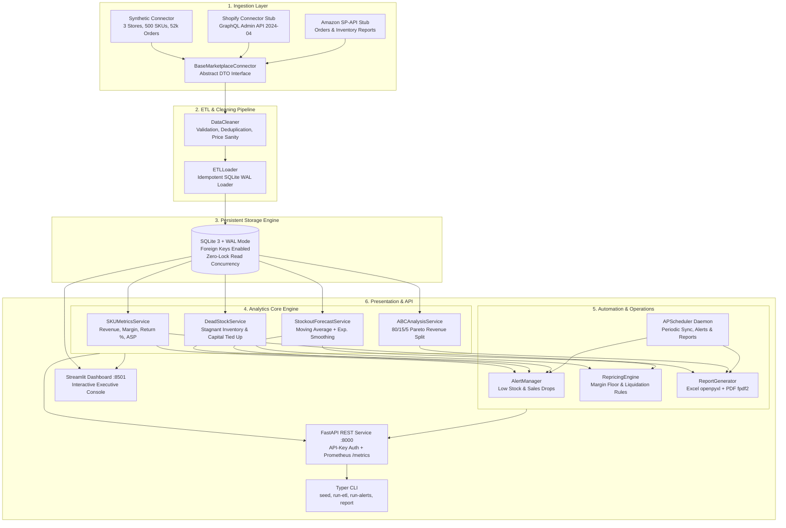
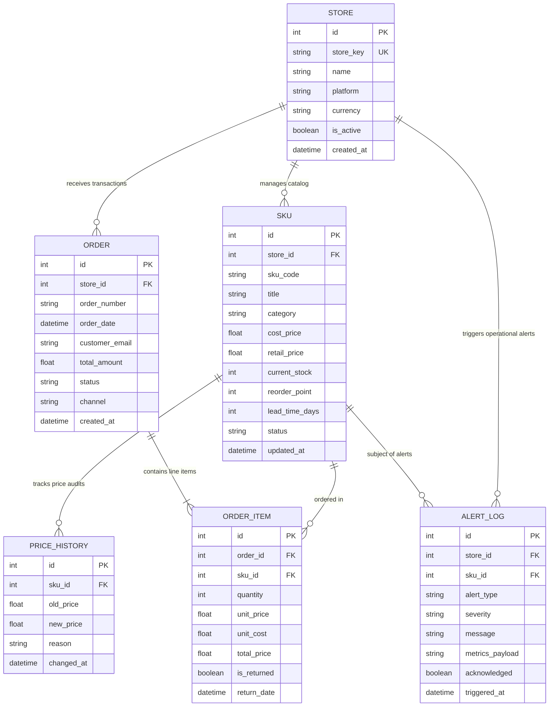
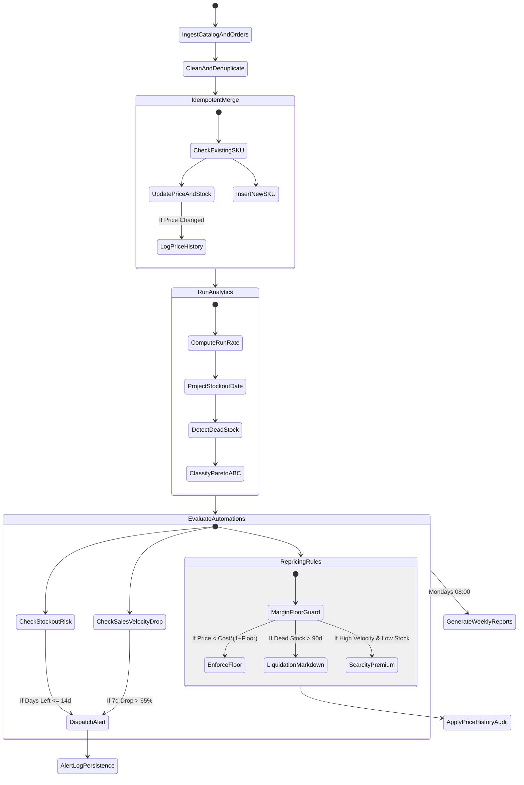

# SellerPulse Architecture & System Design

**SellerPulse** is an end-to-end Marketplace SKU Analytics & Automation Platform engineered for high-volume multichannel e-commerce operations. It handles catalog ingestion, idempotent data transformation, predictive stockout forecasting, ABC Pareto revenue classification, dead stock detection, and automated repricing & alert dispatch.

---

## 1. High-Level System Architecture

---

## 2. Entity-Relationship Data Model

The data model maintains multi-store tenant isolation, referential integrity with cascading deletes where appropriate, and indexed lookup paths on `store_id`, `sku_code`, and `order_date`.

---

## 3. Automation & Repricing State Flow

---

## 4. Key Architectural Decisions

### 4.1 SQLite Write-Ahead Logging (WAL) Mode
- **Decision**: SQLite configured with `PRAGMA journal_mode=WAL;` and `PRAGMA synchronous=NORMAL;`.
- **Rationale**: Standard SQLite locks the entire database file during writes. WAL mode allows concurrent readers while a single writer thread commits transactions, providing high-throughput read operations for the Streamlit dashboard and FastAPI endpoints during heavy ETL load.

### 4.2 Idempotent Loading
- **Decision**: Primary keys and unique business keys (`(store_id, sku_code)` and `(store_id, order_number)`) are pre-indexed and queried before insert.
- **Rationale**: Marketplace sync jobs frequently fail midway due to network timeouts. Idempotency guarantees that re-running the sync will never duplicate revenue, double-count orders, or throw database integrity errors.

### 4.3 Margin Floor Guardrail
- **Decision**: Repricing recommendations must strictly adhere to `cost_price * (1 + margin_floor_pct)`.
- **Rationale**: Automated pricing algorithms in e-commerce can trigger race conditions with competitors (e.g., "race to the bottom"). The hardcoded margin floor prevents selling inventory at a loss.

### 4.4 Decoupled Connector Interface
- **Decision**: All data sources inherit from `BaseMarketplaceConnector` and return normalized Pydantic DTOs (`RawSKU`, `RawOrder`, `RawOrderItem`).
- **Rationale**: Allows instant substitution of the synthetic data generator with real Shopify Admin GraphQL API, Amazon Selling Partner API (SP-API), or BigCommerce connectors without touching downstream ETL, analytics, or UI code.
